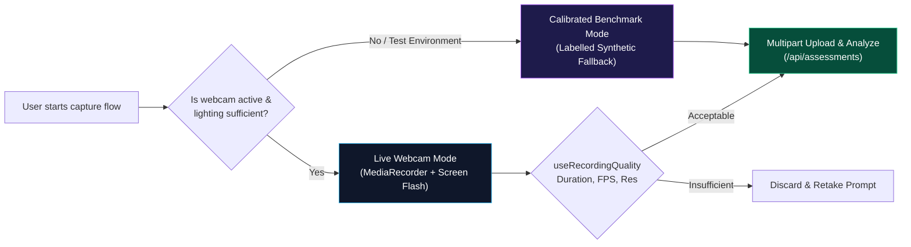
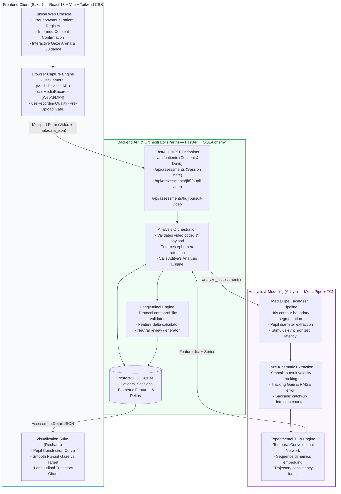

<div align="center">

# OCUTRACK

### A browser-based ocular measurement and longitudinal change-monitoring prototype.

*Objective neurological screening support should not depend on a $25,000 clinic pupillometer.*

[](frontend/package.json)
[](frontend/tsconfig.json)
[](frontend/vite.config.ts)
[](frontend/tailwind.config.js)
[](backend/requirements.txt)
[](backend/requirements.txt)
[](docs/integration-contract.md)
[](PRD.md)

**AI for Medicine: A Global Student Hackathon on the Future of Care**  
*Track: Ocular Biometrics, Neurology & Longitudinal Change Monitoring*

### [Open the Repeatable Demo Guide &rarr;](docs/demo-guide.md)

A standardized, repeatable browser demonstration designed for laptops with a webcam. Includes an explicitly labelled **calibrated benchmark sample fallback** for environments lacking uniform lighting. To run the full stack locally, see [Run It Yourself](#run-it-yourself).

</div>

---

> [!IMPORTANT]
> **Investigational Prototype — Not a Diagnostic Device:** OcuTrack provides quantitative ocular measurements for research observation and clinician review. It **does not** diagnose Parkinson's disease, concussion, diabetic neuropathy, stroke, or any other medical condition. A stable measurement does not establish that a participant is neurologically healthy. All clinical evaluations and referral decisions must be made by qualified healthcare professionals.

---

## Two Ways to Run OcuTrack

The capture suite adapts automatically to demo environment capabilities while preserving data integrity:

| Feature | **Live Webcam Capture Mode** | **Calibrated Benchmark Fallback** |
|---|---|---|
| **Capture Input** | Real-time laptop webcam via `navigator.mediaDevices` | Calibrated synthetic benchmark recording with ground truth |
| **Participant Guidance** | Elliptical reticle overlay with live eye-alignment centering | Automated benchmark playback with documented frame timestamps |
| **Stimulus Source** | Standardized diffuse screen flash stimulus at 5.0s | Pre-synchronized stimulus onset benchmark dataset |
| **Tracking Target** | Interactive 10s smooth pursuit sinusoidal target (`horizontal-sweep-v1`) | Full pre-computed 200-point trajectory metadata alignment |
| **Pre-Upload Quality Gate** | Live evaluation of duration, resolution (720p), and FPS (&ge; 25) | Verified calibrated reference container specs |
| **Report Labelling** | Labelled as **Live Participant Recording** | Explicitly labelled **"Fallback Benchmark Sample"** |
| **Clinical Integrity** | Full biometric extraction & longitudinal comparison | Full biometric extraction & longitudinal comparison |



---

## Why OcuTrack

Subtle ocular motor and pupillary reflexes are among the earliest physiological indicators of neurological and systemic alterations. However, modern healthcare faces three fundamental barriers:

1. **The Equipment Barrier**: Gold-standard clinical pupillometers and infrared gaze trackers cost between **\$5,000 and \$25,000**, restricting objective ocular assessment to specialized tertiary neurology centers.
2. **The "Single-Snapshot" Trap**: Normal physiological variance across the human population is wide. A pupil constriction latency of 260 ms may be pathological for one individual but completely benign for another. A single point-in-time assessment frequently misses subtle progressive changes.
3. **The Accessibility Gap**: Community clinics, rural health posts, and triage centers have access only to penlights and subjective visual inspection, leading to missed early signals or unnecessary specialist burden.

### The OcuTrack Solution

OcuTrack turns any standard laptop browser with a webcam into an objective ocular measurement and longitudinal monitoring console:

- **Personal-Baseline Comparison**: Focuses on **intra-individual longitudinal deltas ($\Delta$)** across standardized visits rather than generic population cutoffs.
- **Controlled In-Browser Stimuli**: Eliminates high-intensity flashlights; uses calibrated diffuse screen illumination flashes and deterministic horizontal pursuit sweep trajectories.
- **Honest Non-Diagnostic Communication**: Reports quantitative physical measurements (milliseconds, mm/s, ratio gain), recording quality flags, and baseline deltas—**never** fabricated disease labels or artificial urgency scores.

---

## End-to-End System Architecture

OcuTrack is organized into three clean, decoupled workstreams adhering to strict interface boundaries:



---

## Complete Workflow & User Journey

```mermaid
flowchart TD
    %% Styling classes
    classDef startEnd fill:#0f172a,stroke:#0284c7,stroke-width:2px,color:#fff;
    classDef page fill:#f8fafc,stroke:#94a3b8,stroke-width:1.5px,color:#0f172a;
    classDef capture fill:#eff6ff,stroke:#2563eb,stroke-width:2px,color:#1e3a8a;
    classDef api fill:#f0fdf4,stroke:#16a34a,stroke-width:2px,color:#14532d;
    classDef gate fill:#fffbeb,stroke:#d97706,stroke-width:2px,color:#78350f;
    classDef alert fill:#fef2f2,stroke:#dc2626,stroke-width:2px,color:#7f1d1d;

    Start(["Healthcare Worker / Evaluator"]) --> Dashboard["Dashboard (/)\n- Overview & Review Metrics\n- Backend Health Status\n- Recent Patient Sessions"]

    Dashboard --> PatientChoice{"Patient Action"}
    PatientChoice -->|"Register New"| Modal["Create Patient Modal\n- Pseudonymous Code (e.g. OT-1042)\n- Age Band\n- Consent Stored"]
    PatientChoice -->|"Select Existing"| PatientList["Patient Registry (/patients)\n- Search by Code\n- Longitudinal Delta Badges"]

    Modal --> NewAssessment["New Assessment Page (/assessments/new)"]
    PatientList --> NewAssessment

    subgraph Phase1 ["1. Pre-Assessment Gate"]
        NewAssessment --> ConsentGate{"Consent Confirmed?"}
        ConsentGate -->|"No"| BlockConsent["Prevent Capture Session"]:::gate
        ConsentGate -->|"Yes"| CreateSession["Create Session (POST /api/assessments)\n- Logs Protocol Version\n- Device Specs & Lighting Setup"]:::api
    end

    subgraph Phase2 ["2. Dual-Test Capture Experience"]
        CreateSession --> PupilTest["Test 1: Pupil Light Reflex (/assessments/:id/pupil-test)"]:::capture
        
        PupilTest --> LiveCam1["Webcam Preview with Reticle Guide\n- 3-Second Countdown\n- 15s Recording via MediaRecorder\n- Diffuse Screen Flash at 5.0s"]
        LiveCam1 --> QualityCheck1["useRecordingQuality\n- Duration &ge; 12s\n- Resolution &ge; 720p\n- FPS &ge; 25"]
        
        QualityCheck1 -->|"Fallback needed"| Fallback1["Labelled Synthetic Benchmark"]:::gate
        QualityCheck1 -->|"Passed"| UploadPupil["Upload Video (POST /pupil-video)\n- Binary WebM/MP4 + metadata_json"]:::api
        Fallback1 --> UploadPupil

        UploadPupil --> PursuitTest["Test 2: Smooth-Pursuit Test (/assessments/:id/pursuit-test)"]:::capture
        
        PursuitTest --> LiveCam2["Horizontal Target Sweeper\n- 10s Deterministic Sine Wave\n- Logs [x, y] coordinates every 50ms\n- Synchronized with video recording"]
        LiveCam2 --> QualityCheck2["useRecordingQuality\n- Duration &ge; 8s\n- Trajectory Points Logged"]
        
        QualityCheck2 -->|"Passed"| UploadPursuit["Upload Pursuit & Trajectory (POST /pursuit-video)\n+ Trigger Analysis (POST /analyze)"]:::api
    end

    subgraph Phase3 ["3. Analysis & Polling"]
        UploadPursuit --> Processing["Processing Page (/assessments/:id/processing)"]:::page
        Processing --> PollingLoop["Honest 6-Stage Pipeline Poller\n1. Video Validation\n2. Quality & Usability Check\n3. Iris & Pupil Segmentation\n4. Biometric Feature Extraction\n5. Experimental TCN Dynamics\n6. Baseline Longitudinal Delta"]
        PollingLoop --> StatusCheck{"Status Check"}
        StatusCheck -->|"processing"| PollingLoop
        StatusCheck -->|"complete"| Report["Assessment Report (/assessments/:id/report)"]:::page
        StatusCheck -->|"failed"| ErrorView["Analysis Failure / Retry"]:::alert
    end

    subgraph Phase4 ["4. Clinical Visualization & History"]
        Report --> QualityGate{"Quality Acceptable?"}
        QualityGate -->|"insufficient"| QualityWarning["Prominent Banner:\n'Insufficient recording quality — repeat test'\n- Features tagged Unvalidated\n- 1-Click Repeat Assessment"]:::alert
        QualityGate -->|"acceptable"| ValidReport["Biometric Results View\n- Pupil Curve & Latency/Velocity\n- Pursuit Gain & RMSE Kinematics\n- Baseline Delta Table\n- Experimental TCN Model Card"]

        ValidReport --> PatientHistory["Patient Profile (/patients/:id)\n- Across-Visit Trajectory Chart\n- Baseline History Table"]
        PatientHistory --> Dashboard
    end

    class Start,Dashboard,Report,PatientHistory startEnd;
```



---

## Extracted Biometrics & Measurement Standards

All features extracted by the pipeline adhere to strictly defined physical and kinematic units:

### 1. Pupil Light Reflex (PLR) Biometrics
| Metric | Unit | Calculation Method | Clinical Interpretation Context |
|---|---|---|---|
| **Baseline Diameter** | `mm` | Mean pupil diameter during initial 0.0s – 4.8s dark-adapted baseline | Anatomical resting state under controlled ambient lighting |
| **Constriction Latency** | `ms` | Elapsed time from screen flash stimulus onset (5000 ms) to initial acceleration of pupil contraction ($> 5\%$ drop) | Afferent/efferent parasympathetic conduction speed |
| **Max Constriction Velocity** | `mm/s` | Peak negative first derivative ($\frac{dD}{dt}$) during reflexive constriction phase | Neuromuscular constriction dynamics |
| **Constriction Amplitude** | `%` | Percentage change in diameter from baseline to minimum constriction | Total reflex contraction magnitude |
| **Average Dilation Velocity** | `mm/s` | Mean slope during pupil redilation recovery phase | Sympathetic re-dilation autonomic tone |

### 2. Smooth-Pursuit Eye Movement (SPEM) Kinematics
| Metric | Unit | Calculation Method | Clinical Interpretation Context |
|---|---|---|---|
| **Tracking Gain** | `ratio` | Ratio of eye angular velocity to target sweep velocity ($\frac{V_{eye}}{V_{target}}$) | Velocity tracking fidelity (normal range: 0.85 – 1.05) |
| **Tracking RMSE** | `norm` | Root-mean-square spatial deviation between normalized target position and estimated gaze position | Trajectory stability and gaze fixation accuracy |
| **Catch-up Saccades** | `count` | Number of rapid compensatory gaze jumps detected during smooth pursuit | Corrective movements compensating for low tracking gain |

---

## Technology Stack

| Workstream | Technology | Purpose & Responsibility |
|---|---|---|
| **Frontend Framework** | React 18 + Vite | Modular, reactive single-page client with sub-second hot reload |
| **Language & Typings** | TypeScript 5.6 | Strict compile-time data types matching backend contracts |
| **Styling & Design System** | Tailwind CSS + Lucide Icons | Calm, clinical user interface with neutral surfaces and high contrast |
| **Visualization Engine** | Recharts 3.x | Time-series charting for pupil curves, pursuit kinematics, and longitudinal trajectories |
| **Browser Media APIs** | MediaDevices + MediaRecorder | Explicit webcam access, constraints tracking, and WebM/MP4 encoding |
| **Backend Framework** | FastAPI (Python 3.14) | High-performance asynchronous REST API and request validation |
| **Persistence Layer** | SQLAlchemy 2.0 + SQLite / PostgreSQL | Structured persistence for patients, assessments, features, and comparisons |
| **Computer Vision Engine** | MediaPipe + OpenCV | Iris landmark segmentation, pupil contour detection, and frame quality filtering |
| **Deep Learning** | Temporal Convolutional Network (TCN) | Multi-scale temporal sequence dynamics evaluation |
| **Testing** | Vitest + React Testing Library + Pytest | 100% passing automated test suites across frontend and backend |

---

## Run It Yourself

### Prerequisites
- Node.js &ge; 18.x
- Python &ge; 3.10 (3.12 / 3.14 supported)
- Google Chrome (recommended for webcam MediaRecorder support)

### 1. Launch the Frontend

```bash
# Navigate to the frontend directory
cd frontend

# Install dependencies
npm install

# Run development server
npm run dev
```

The frontend will start at **`http://localhost:3000`**.

To run automated frontend unit and component tests:
```bash
npm test
```

To verify the production build:
```bash
npm run build
```

### 2. Launch the Backend API

```bash
# In another terminal from repository root
cd backend

# Install dependencies
pip install -r requirements.txt

# Run the FastAPI server
python -m uvicorn app.main:app --app-dir . --port 8000 --reload
```

The backend API will start at **`http://localhost:8000`**.
- Interactive Swagger documentation: **`http://localhost:8000/docs`**
- Health check endpoint: **`http://localhost:8000/api/health`**

To run automated backend tests:
```bash
python -m pytest tests
```

---

## Privacy, Security & Data Governance

- **Zero Direct Identifiers (PII/PHI)**: OcuTrack stores only pseudonymous participant research codes (e.g. `OT-0001`) and broad age bands (`40-49`). Real names, dates of birth, phone numbers, and addresses are strictly prohibited.
- **Informed Consent Gate**: Video capture cannot proceed without an affirmative user confirmation of informed participant consent.
- **Ephemeral Video Processing**: Video files uploaded to the backend are held temporarily in private isolation during automated feature extraction and are deleted by default immediately upon analysis completion.
- **No Third-Party Telemetry**: Raw videos, biometric time series, and patient records are never transmitted to external analytics providers.

---

## Clinical Regulatory Guardrails

OcuTrack strictly enforces neutral, observation-based communication across the entire interface and API:

| Prohibited Language (Never Displayed) | Permitted Language (Used by OcuTrack) |
|---|---|
| ❌ *"Parkinson's Disease Detected"* | ✅ `Change detected — consider repeat measurement and clinical review` |
| ❌ *"Neurologically Healthy / Normal"* | ✅ `No notable change detected in measured features` |
| ❌ *"Urgent High Risk (94% Probability)"* | ✅ `Recording quality acceptable` |
| ❌ Interpreting unvalidated poor recordings | ✅ `Insufficient recording quality — repeat test` |
| ❌ *"Clinical Diagnostic Neural Prediction"* | ✅ `Experimental model output; not clinically validated` |

---

## Team

| | |
|---|---|
| **Hackathon** | [AI for Medicine: A Global Student Hackathon on the Future of Care](PRD.md) |
| **Track** | Ocular Biometrics, Neurology & Longitudinal Change Monitoring |
| **Core Problem** | Primary care clinics lack accessible, objective tools to track neurological changes over time because clinical pupillometers/eye-trackers cost \$5,000–\$25,000. |
| **Solution** | OcuTrack — a browser-based, webcam-driven personal-baseline monitoring prototype that extracts standardized pupil reflexes and smooth-pursuit eye movements. |
| **Sakar Arya** · [sakararya43@gmail.com](mailto:sakararya43@gmail.com) · [@sakararya43-web](https://github.com/sakararya43-web) | **Frontend & Capture**: React 18, Vite, TypeScript, Tailwind CSS, MediaDevices camera hook, browser video recording (`MediaRecorder`), smooth pursuit gaze stimulus, reporting visualizations, and client-side quality validation. |
| **Aditya** · [adityazxr27@gmail.com](mailto:adityazxr27@gmail.com) | **Computer Vision & ML Modeling**: MediaPipe FaceMesh iris/pupil localization, constriction velocity and latency extraction, gaze kinematics (gain/RMSE), and experimental Temporal Convolutional Network (TCN). |
| **Parth** · [parth2010a@gmail.com](mailto:parth2010a@gmail.com) | **Backend & Architecture**: FastAPI REST services, Pydantic data schemas, Supabase PostgreSQL / SQLite persistence, video upload validation, temporary retention cleanup, and longitudinal comparison engine. |

---

## Further Documentation

| Document | Purpose |
|---|---|
| [Shared Integration Contract](docs/integration-contract.md) | Locked specification of all 11 API endpoints, schemas, status enums, biometric units, and video constraints |
| [Hackathon Demo Guide](docs/demo-guide.md) | Step-by-step evaluator presentation guide for live and benchmark demonstrations |
| [Product Requirements Document (PRD)](PRD.md) | Parent specification detailing medical context, non-diagnostic guardrails, and functional requirements |
| [Sakar Implementation Plan](sakarImplementation.md) | Frontend architecture, hook specifications, component hierarchy, and verification checklist |
| [Parth Implementation Plan](parthImplementation.md) | Backend service architecture, database schema, orchestration logic, and API endpoints |
| [Aditya Implementation Plan](adityaImplementation.md) | Computer vision pipeline, landmark tracking, feature calculation algorithms, and TCN model architecture |

---

<div align="center">
<sub>Built with precision for the AI for Medicine Global Student Hackathon. OcuTrack is an investigational software prototype and not an FDA/CE-cleared diagnostic medical device.</sub>
</div>
