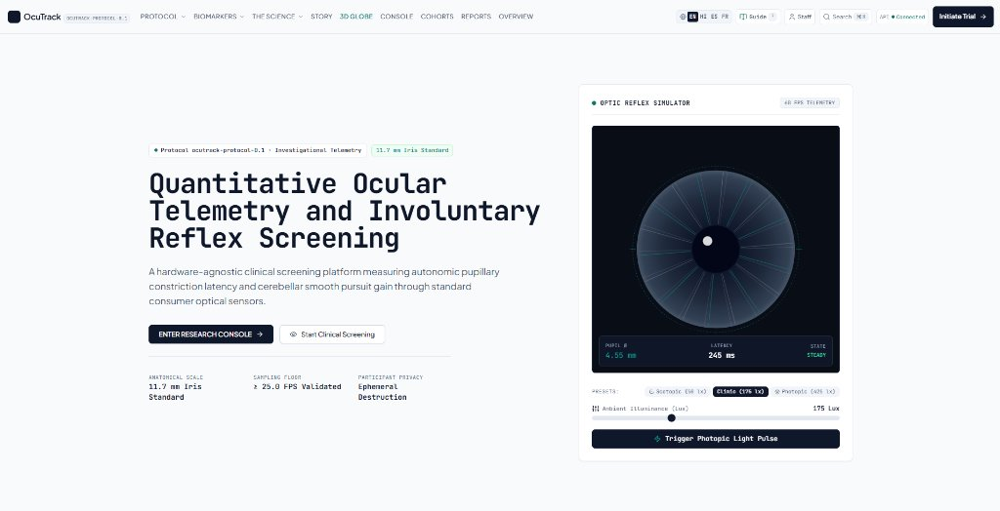
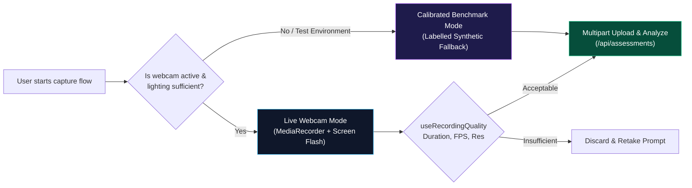
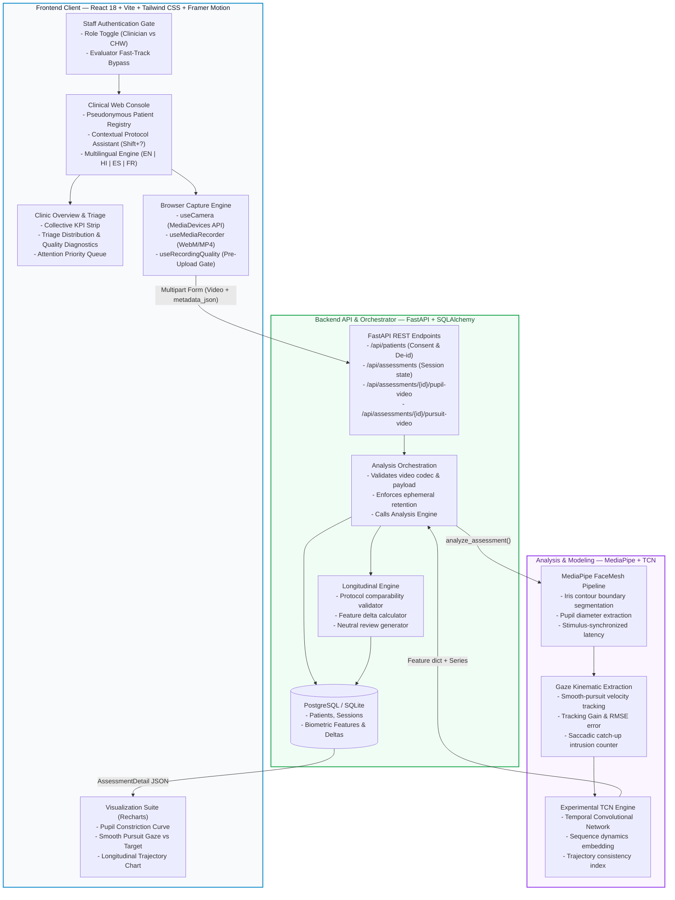

<div align="center">

# OCUTRACK

### Browser-Based Quantitative Ocular Telemetry & Longitudinal Baseline Delta Engine

*Objective neuro-ophthalmic screening support should not depend on a $25,000 clinic pupillometer.*

[](frontend/package.json)
[](frontend/tsconfig.json)
[](frontend/vite.config.ts)
[](frontend/tailwind.config.js)
[](backend/requirements.txt)
[](backend/requirements.txt)
[](docs/integration-contract.md)
[](frontend/src/i18n/)
[](frontend/src/context/AuthContext.tsx)
[](PRD.md)

**AI for Medicine: A Global Student Hackathon on the Future of Care**  
*Track: Ocular Biometrics, Neurology & Longitudinal Change Monitoring*

<br />



</div>

---

> [!IMPORTANT]
> **Investigational Prototype : Not a Diagnostic Device:** OcuTrack provides quantitative ocular measurements for research observation and clinician review. It **does not** diagnose Parkinson's disease, concussion, diabetic neuropathy, stroke, or any other medical condition. A stable measurement does not establish that a participant is neurologically healthy. All clinical evaluations and referral decisions must be made by qualified healthcare professionals.

---

## What is OcuTrack?

OcuTrack turns standard laptop webcams into calibrated, objective ocular measurement tools for frontline health screeners and supervising neurologists. Instead of relying on expensive proprietary hardware, OcuTrack delivers:

1. **Standardized Pupillary Light Reflex (PLR) Capture**: 15-second protocol measuring dark-adapted resting baseline, flash response at 5.0s, maximum constriction velocity, and redilation kinetics at 30 FPS.
2. **Horizontal Smooth-Pursuit Kinematics (SPEM)**: 10-second horizontal sinusoidal target tracking evaluating velocity tracking gain, root-mean-square spatial error (RMSE), and catch-up saccadic intrusions.
3. **Intra-Individual Longitudinal Comparison ($\Delta$)**: Evaluates percent changes against each patient's own historical baseline rather than noisy, uncalibrated population averages.
4. **Automated Usability & Quality Gating**: Client-side validation (`useRecordingQuality`) enforcing &ge; 720p resolution, frame rate calibration (&ge; 25-30 FPS), and &ge; 80% ocular feature visibility.

---

## New Clinical Feature Suite

### 1. Hospital Staff Authentication & Evaluator Fast-Track (`/login`)
- **Role-Based Access Control**: Differentiates between **Community Health Workers** (primary screeners) and **Supervising Clinicians** (neurologists / review physicians).
- **Dual-Mode Persistence**: Seamlessly connects to Supabase Auth when credentials exist, with an instant local demo-session fallback (`localStorage`) so the application never breaks offline.
- **Judge / Evaluator Fast-Track**: Prominent one-click fast-track buttons allowing hackathon evaluators to bypass database setup and enter pre-configured clinical profiles instantly (`Dr. Elena Vance` or `Aarav Sharma`).
- **Staff Identity Indicator**: Compact, persistent navigation badge displaying active user identity, ward designation, clinical role, and one-click sign out.

### 2. Contextual Clinical Protocol Assistant (`Shift + ?`)
- **Deterministic Screen-Aware Guide Drawer**: Slides over smoothly using Framer Motion with backdrop blur. Strictly zero LLM hallucination risk: 100% deterministic clinical standard operating procedures (SOPs).
- **Automatic Route Context Matching**: Automatically detects the active screen (`/login`, `/`, `/patients`, `/assessments/new`, `/pupil-test`, `/pursuit-test`, `/reports`, `/clinic-overview`, `/about`) and pins the corresponding protocol to the top with an `[ ACTIVE CONTEXT ]` beacon.
- **Interactive Search & Troubleshooting Accordion**: Client-side keyword search across 9 clinical SOP specifications and 5 interactive troubleshooting procedures (camera permissions, insufficient quality flags, ambient lux adaptation, baseline delta math, pseudonymous data security).
- **Global Keyboard Shortcut**: Toggleable from anywhere in the application via `Shift + ?` (or `?`) and dismissed via `Escape`.

### 3. Global Multilingual Localization Engine (`i18n`)
- **4-Language Support**: Complete dictionaries for **English (`en`)**, **Hindi (`hi`)**, **Spanish (`es`)**, and **French (`fr`)**.
- **Tactile Top-Bar Selector**: Rectangular `EN | HI | ES | FR` toggle in the header with Framer Motion layout spring animation.
- **System-Wide Translation**: Covers landing page storytelling, research console, patient test protocols, illumination guidelines, clinical status badges, and legal governance disclosures.
- **Persistence & Sync**: Preserves user language preference in `localStorage` (`ocutrack_language`) and synchronizes `<html lang>`.

### 4. Clinic Triage & Collective Quality Dashboard (`/clinic-overview`)
- **4-Card Telemetry KPI Strip**:
  - *Total Assessments Logged* (with 7-day rolling delta).
  - *Attention Priority Queue* (active count of flagged sessions requiring repeat testing or clinician review).
  - *Recording Quality Pass Rate (%)* (monitored against the &ge; 90.0% clinic quality threshold).
  - *Active Longitudinal Cohort* (patients with 2 or more comparable historical visits).
- **Interactive Collective Analytics (Recharts)**:
  - *Triage Status Distribution Over Time*: Stacked volume chart tracking `No Notable Change`, `Change Detected`, and `Insufficient Quality` with `7D`, `30D`, and `All Time` filters.
  - *Field Failure Diagnostics*: Dual-axis trendline mapping usable eye frame ratio against primary field degradation drivers (ambient glare, eyelid squinting, head motion, low FPS).
- **Attention Priority Queue Table**: Sortable and filterable queue surfacing patients with significant baseline deltas, equipped with direct "Inspect Comparison" links.
- **Scientific Guardrail**: Declares an explicit policy against unscientific cross-patient pupil averaging to prevent diagnostic false positives.
- **Offline / Evaluator Dataset Toggle**: Switch between live backend records and calibrated sample clinic telemetry.

### 5. Interactive 3D Ocular Telemetry & Scientific Showcase
- **Three.js 3D Eye Anatomy Explorer**: Anatomical visualization demonstrating MediaPipe iris contour localization and corneal light reflection tracking.
- **Interactive PLR & Pursuit Sandboxes**: Interactive constriction slider and sinusoidal velocity tracking target with realistic audio/haptic telemetry feedback.

---

## Two Ways to Run OcuTrack

The capture suite adapts automatically to demo environment capabilities while preserving data integrity:

| Feature | **Live Webcam Capture Mode** | **Calibrated Benchmark Fallback** |
|---|---|---|
| **Capture Input** | Real-time laptop webcam via `navigator.mediaDevices` | Calibrated synthetic benchmark recording with ground truth |
| **Participant Guidance** | Elliptical reticle overlay with live eye-alignment centering | Automated benchmark playback with documented frame timestamps |
| **Stimulus Source** | Standardized diffuse screen flash stimulus at 5.0s | Pre-synchronized stimulus onset benchmark dataset |
| **Tracking Target** | Interactive 10s smooth pursuit sinusoidal target (`horizontal-sweep-v1`) | Full pre-computed 200-point trajectory metadata alignment |
| **Pre-Upload Quality Gate** | Live evaluation of duration, resolution (720p), and FPS (&ge; 25) | Verified calibrated reference container specs |
| **Report Labelling** | Labelled as **Live Participant Recording** | Explicitly labelled **"Fallback Benchmark Sample"** |
| **Clinical Integrity** | Full biometric extraction & longitudinal comparison | Full biometric extraction & longitudinal comparison |



---

## End-to-End System Architecture



---

## Complete Workflow & User Journey

```mermaid
flowchart TD
    classDef startEnd fill:#0f172a,stroke:#0284c7,stroke-width:2px,color:#fff;
    classDef page fill:#f8fafc,stroke:#94a3b8,stroke-width:1.5px,color:#0f172a;
    classDef capture fill:#eff6ff,stroke:#2563eb,stroke-width:2px,color:#1e3a8a;
    classDef api fill:#f0fdf4,stroke:#16a34a,stroke-width:2px,color:#14532d;
    classDef gate fill:#fffbeb,stroke:#d97706,stroke-width:2px,color:#78350f;
    classDef alert fill:#fef2f2,stroke:#dc2626,stroke-width:2px,color:#7f1d1d;

    Start(["Healthcare Screener / Judge"]) --> Login["Hospital Staff Portal (/login)\n- Role Selector: Clinician vs CHW\n- 1-Click Evaluator Fast-Track"]:::page
    Login --> Dashboard["Workspace (/)\n- Active Protocol Badge: v0.1\n- Language Switcher: EN, HI, ES, FR\n- Protocol Guide: Shift + ?"]:::page

    Dashboard --> OverviewLink{"View Clinic Load?"}
    OverviewLink -->|"Yes"| ClinicOverview["Clinic Overview (/clinic-overview)\n- 4-Card Telemetry KPI Strip\n- Triage Trends & Quality Diagnostics\n- Attention Priority Queue"]:::page

    Dashboard --> PatientChoice{"Patient Action"}
    PatientChoice -->|"Register New"| Modal["Create Patient Modal\n- Pseudonymous Code (e.g. PT-2026-0812)\n- Age Band\n- Documented Consent"]
    PatientChoice -->|"Select Existing"| PatientList["Patient Registry (/patients)\n- Search by Code\n- Longitudinal Delta Badges"]

    Modal --> NewAssessment["New Assessment Page (/assessments/new)"]
    PatientList --> NewAssessment

    subgraph Phase1 ["1. Pre-Assessment Gate"]
        NewAssessment --> ConsentGate{"Consent Confirmed?"}
        ConsentGate -->|"No"| BlockConsent["Prevent Capture Session"]:::gate
        ConsentGate -->|"Yes"| CreateSession["Create Session (POST /api/assessments)\n- Protocol Version Logged\n- Ambient Lux & Camera Checked"]:::api
    end

    subgraph Phase2 ["2. Dual-Test Capture Experience"]
        CreateSession --> PupilTest["Test 1: Pupil Light Reflex (/assessments/:id/pupil-test)"]:::capture
        
        PupilTest --> LiveCam1["Webcam Preview with Reticle Guide\n- 5s Dark Adaptation Baseline\n- Full-Screen Flash at 5.0s\n- 10s Optical Recovery Tracking"]
        LiveCam1 --> QualityCheck1["useRecordingQuality\n- Duration &ge; 12s\n- Resolution &ge; 720p\n- FPS &ge; 25"]
        
        QualityCheck1 -->|"Fallback needed"| Fallback1["Labelled Synthetic Benchmark"]:::gate
        QualityCheck1 -->|"Passed"| UploadPupil["Upload Video (POST /pupil-video)\n- Binary WebM/MP4 + metadata_json"]:::api
        Fallback1 --> UploadPupil

        UploadPupil --> PursuitTest["Test 2: Smooth-Pursuit Test (/assessments/:id/pursuit-test)"]:::capture
        
        PursuitTest --> LiveCam2["Horizontal Target Sweeper\n- 10s Sinusoidal Reticle (0.2-0.4 Hz)\n- Synchronized Coordinate Stream\n- Zero Head Motion Guidance"]
        LiveCam2 --> QualityCheck2["useRecordingQuality\n- Duration &ge; 8s\n- Trajectory Points Logged"]
        
        QualityCheck2 -->|"Passed"| UploadPursuit["Upload Pursuit & Trajectory (POST /pursuit-video)\n+ Trigger Analysis (POST /analyze)"]:::api
    end

    subgraph Phase3 ["3. Analysis & Polling"]
        UploadPursuit --> Processing["Processing Page (/assessments/:id/processing)"]:::page
        Processing --> PollingLoop["Honest Pipeline Poller\n- Optical Pupil Constriction Loader\n- Live Telemetry Waveform Animation\n- Real-Time Backend Status Poll"]
        PollingLoop --> StatusCheck{"Status Check"}
        StatusCheck -->|"processing"| PollingLoop
        StatusCheck -->|"complete"| Report["Assessment Report (/assessments/:id/report)"]:::page
        StatusCheck -->|"failed"| ErrorView["Analysis Failure / Retry"]:::alert
    end

    subgraph Phase4 ["4. Clinical Visualization & Review"]
        Report --> QualityGate{"Quality Acceptable?"}
        QualityGate -->|"insufficient"| QualityWarning["Quality Banner:\n'Insufficient recording quality : repeat test'\n- Features tagged Unvalidated\n- Repeat Assessment Prompt"]:::alert
        QualityGate -->|"acceptable"| ValidReport["Biometric Results View\n- Pupil Constriction Curve & Latency\n- Pursuit Gain & RMSE Error\n- Personal Baseline Delta Table (%)\n- Experimental TCN Kinematics"]

        ValidReport --> PatientHistory["Patient Profile (/patients/:id)\n- Longitudinal Trajectory Chart\n- Personal Baseline Reference Table"]
        PatientHistory --> Dashboard
    end

    class Start,Dashboard,Report,PatientHistory startEnd;
```



---

## Extracted Biometrics & Measurement Standards

All parameters extracted by the computer vision pipeline adhere to strictly defined physical and kinematic units:

### 1. Pupil Light Reflex (PLR) Biometrics
| Metric | Unit | Calculation Method | Clinical Interpretation Context |
|---|---|---|---|
| **Baseline Diameter** | `mm` | Mean pupil diameter during initial 0.0s – 4.8s dark-adapted baseline | Anatomical resting state under controlled ambient lighting |
| **Constriction Latency** | `ms` | Elapsed time from screen flash stimulus onset (5000 ms) to initial acceleration of pupil contraction ($> 5\%$ drop) | Afferent/efferent parasympathetic conduction speed |
| **Max Constriction Velocity** | `mm/s` | Peak negative first derivative ($\frac{dD}{dt}$) during reflexive constriction phase | Neuromuscular constriction dynamics |
| **Constriction Amplitude** | `%` | Percentage change in diameter from baseline to minimum constriction | Total reflex contraction magnitude |
| **Average Dilation Velocity** | `mm/s` | Mean slope during pupil redilation recovery phase | Sympathetic re-dilation autonomic tone |

### 2. Smooth-Pursuit Eye Movement (SPEM) Kinematics
| Metric | Unit | Calculation Method | Clinical Interpretation Context |
|---|---|---|---|
| **Tracking Gain** | `ratio` | Ratio of eye angular velocity to target sweep velocity ($\frac{V_{eye}}{V_{target}}$) | Velocity tracking fidelity (normal reference: 0.85 – 1.05) |
| **Tracking RMSE** | `norm` | Root-mean-square spatial deviation between target position and estimated gaze position | Trajectory stability and gaze fixation accuracy |
| **Catch-up Saccades** | `count` | Number of rapid compensatory gaze jumps detected during smooth pursuit | Corrective movements compensating for low tracking gain |

---

## Technology Stack

| Component | Technology | Role & Purpose |
|---|---|---|
| **Frontend Framework** | React 18 + Vite | High-performance modular reactive single-page application |
| **Language & Typings** | TypeScript 5.6 | Strict compile-time typing aligned 100% with FastAPI Pydantic schemas |
| **UI Design System** | Tailwind CSS + Lucide Icons | Clinical Precision Maximalism: dense bento grids, hairline borders, zero pill buttons |
| **Kinetic Motion** | Framer Motion | Hardware-inspired spring physics, page transitions, tactile buttons, slide-over drawer |
| **3D Graphics** | Three.js | Real-time interactive 3D ocular anatomy explorer and gaze mechanics |
| **Localization (i18n)** | Custom React Context Engine | Zero-dependency 4-language localization (EN, HI, ES, FR) with `localStorage` persistence |
| **Authentication** | Supabase JS + Demo Fallback | Role-based clinical staff gate with one-click evaluator fast-track bypass |
| **Visualization Engine** | Recharts 3.x | Ocular time-series curves, pursuit tracking, longitudinal trends, and collective triage charts |
| **Browser Media APIs** | MediaDevices + MediaRecorder | Hardware camera negotiation, 720p constraints, WebM/MP4 chunk recording |
| **Backend Framework** | FastAPI (Python 3.12+) | High-throughput asynchronous REST API and request validation |
| **Persistence Layer** | SQLAlchemy 2.0 + SQLite / PostgreSQL | Structured persistence for pseudonymous patients, sessions, features, and deltas |
| **Computer Vision Engine** | MediaPipe + OpenCV | Iris landmark segmentation, pupil contour detection, frame quality filtering |
| **Deep Learning** | Temporal Convolutional Network (TCN) | Multi-scale temporal sequence dynamics evaluation |
| **Automated Testing** | Vitest + Testing Library + Pytest | 100% passing test suites across both frontend and backend |

---

## Run It Yourself

### Prerequisites
- Node.js &ge; 18.x
- Python &ge; 3.10 (3.12 recommended)
- Google Chrome (recommended for webcam MediaRecorder support)

### 1. Launch the Frontend

```bash
# Navigate to the frontend directory
cd frontend

# Install dependencies
npm install

# Run development server
npm run dev
```

The frontend will start at **`http://localhost:5173`** (or `http://localhost:3000`).

To run the automated test suite:
```bash
npm test
```

To run a production TypeScript and Vite bundle build:
```bash
npm run build
```

### 2. Launch the Backend API

```bash
# In another terminal from repository root
cd backend

# Install dependencies
pip install -r requirements.txt

# Run the FastAPI server
python -m uvicorn app.main:app --app-dir . --port 8000 --reload
```

The backend API will start at **`http://localhost:8000`**.
- Interactive Swagger documentation: **`http://localhost:8000/docs`**
- Health check endpoint: **`http://localhost:8000/api/health`**

To run automated backend tests:
```bash
python -m pytest tests
```

### 3. Evaluator Fast-Track Quickstart
1. Open `http://localhost:5173`.
2. On `/login`, click **"Dr. Elena Vance (Clinician)"** or **"Aarav Sharma (Community Health Worker)"** for instant one-click evaluator login without entering credentials.
3. Use the top navigation bar to switch between **English**, **हिन्दी**, **Español**, or **Français**.
4. Press **`Shift + ?`** (or click **Protocol Guide** in the header) to open the screen-aware clinical guidance drawer.
5. Click **Clinic Overview** to inspect collective triage queues and capture quality diagnostics.

---

## Privacy, Security & Data Governance

- **Zero Direct Identifiers (PII/PHI)**: OcuTrack stores only pseudonymous participant research codes (e.g. `PT-2026-0812`) and broad age bands (`40-49`). Real names, dates of birth, phone numbers, and addresses are strictly prohibited.
- **Informed Consent Gate**: Video capture cannot proceed without affirmative confirmation of informed participant consent.
- **Ephemeral Video Processing**: Video files uploaded to the backend are held temporarily in private isolation during automated feature extraction and are deleted by default immediately upon analysis completion.
- **No Third-Party Telemetry**: Raw videos, biometric time series, and patient records are never transmitted to external commercial analytics providers.

---

## Clinical Regulatory Guardrails

OcuTrack strictly enforces neutral, observation-based communication across the entire interface and API:

| Prohibited Language (Never Displayed) | Permitted Language (Used by OcuTrack) |
|---|---|
| ❌ *"Parkinson's Disease Detected"* | ✅ `Change detected : consider repeat measurement and clinical review` |
| ❌ *"Neurologically Healthy / Normal"* | ✅ `No notable change detected in measured features` |
| ❌ *"Urgent High Risk (94% Probability)"* | ✅ `Recording quality acceptable` |
| ❌ Interpreting unvalidated poor recordings | ✅ `Insufficient recording quality : repeat test` |
| ❌ *"Clinical Diagnostic Neural Prediction"* | ✅ `Experimental model output; not clinically validated` |

---

## Team

| Role / Member | Focus & Workstream |
|---|---|
| **Sakar Arya** · [sakararya43@gmail.com](mailto:sakararya43@gmail.com) · [@sakararya43-web](https://github.com/sakararya43-web) | **Frontend & Capture**: React 18, Vite, TypeScript, Tailwind CSS, MediaDevices camera hook, browser video recording (`MediaRecorder`), smooth pursuit gaze stimulus, reporting visualizations, and client-side quality validation. |
| **Aditya** · [adityazxr27@gmail.com](mailto:adityazxr27@gmail.com) | **Computer Vision & ML Modeling**: MediaPipe FaceMesh iris/pupil localization, constriction velocity and latency extraction, gaze kinematics (gain/RMSE), and experimental Temporal Convolutional Network (TCN). |
| **Parth** · [parth2010a@gmail.com](mailto:parth2010a@gmail.com) | **Backend & Architecture**: FastAPI REST services, Pydantic data schemas, Supabase PostgreSQL / SQLite persistence, video upload validation, temporary retention cleanup, and longitudinal comparison engine. |

---

## Further Documentation

| Document | Purpose |
|---|---|
| [Shared Integration Contract](docs/integration-contract.md) | Locked specification of all 11 API endpoints, schemas, status enums, biometric units, and video constraints |
| [Hackathon Demo Guide](docs/demo-guide.md) | Step-by-step evaluator presentation guide for live and benchmark demonstrations |
| [Product Requirements Document (PRD)](PRD.md) | Parent specification detailing medical context, non-diagnostic guardrails, and functional requirements |
| [Sakar Implementation Plan](sakarImplementation.md) | Frontend architecture, hook specifications, component hierarchy, and verification checklist |
| [Parth Implementation Plan](parthImplementation.md) | Backend service architecture, database schema, orchestration logic, and API endpoints |
| [Aditya Implementation Plan](adityaImplementation.md) | Computer vision pipeline, landmark tracking, feature calculation algorithms, and TCN model architecture |

---

<div align="center">
<sub>Built with precision for the AI for Medicine Global Student Hackathon. OcuTrack is an investigational software prototype and not an FDA/CE-cleared diagnostic medical device.</sub>
</div>
